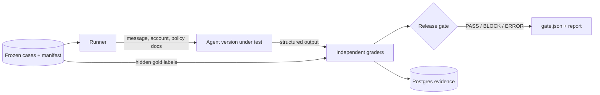

# Support Reliability Lab

An evaluation and release-gate service for AI customer-support agents, written in TypeScript.

A support agent can sound helpful while breaking the rules that matter. It might promise a refund it cannot issue, treat a cancellation as a cash reimbursement, skip an escalation, cite a stale policy, or leak another workspace's data. This project replays a frozen set of support cases through versioned agent builds, scores each answer with deterministic graders that are independent of the agent, and blocks a release when a critical behavior regresses.

Everything runs offline on synthetic data. There are no API keys, real accounts, or payment systems, and no paid model calls.

I built it around the problems a support systems engineering role deals with every day: agent routing and escalation, eval rubrics, release gates, and billing guardrails. The support policy (`SYN-POLICY-1`) and every customer record are fictional and not affiliated with any company.

## Status

| Milestone                                                                    | State   |
| ---------------------------------------------------------------------------- | ------- |
| Workspace, config validation, liveness endpoint, local Postgres, CI          | Done    |
| Agent contracts and the `SYN-POLICY-1` registry                              | Done    |
| Dataset integrity checks and gold-label review log for the 80-case fixture   | Done    |
| Reference agent, independent graders, Postgres runner, release gate, API, UI | Planned |

The full plan, with acceptance criteria for each milestone, is in [`docs/ROADMAP.md`](docs/ROADMAP.md).

## How it works



The design rests on four guarantees:

- **The agent never sees the answers.** Gold labels go only to the graders. `toAgentVisibleInput` builds the agent input from the message, account context, and supplied policy documents, and a test asserts that no label reaches it.
- **Proposals are not actions.** An agent can propose a refund review, a cancellation at renewal, or a credit-restoration review. Nothing executes them, and claiming one completed is a critical failure.
- **The gate fails closed.** A grader error, timeout, or missing result blocks the release. It is never counted as a pass.
- **Evidence is pinned.** The policy file, each policy document, and the dataset are SHA-256 hashed, so a silent edit fails a test.

## Quick start

Requires Node.js 24 (`.nvmrc` pins 24.21.0), pnpm 10, and Docker.

```bash
corepack enable
pnpm install --frozen-lockfile
pnpm lint && pnpm format:check && pnpm typecheck && pnpm test
pnpm eval:validate-data                   # hash, schema, counts, policy references

cp .env.example .env
docker compose up -d db
pnpm dev                                  # http://127.0.0.1:3000
curl http://127.0.0.1:3000/health/live    # {"status":"ok"}
```

If port 5432 is already in use, run `POSTGRES_PORT=5433 docker compose up -d db` and update `DATABASE_URL` in `.env` to match.

The server binds to `127.0.0.1` only, and startup is rejected if `MODEL_ENABLED` or `ALLOW_EXTERNAL_CALLS` is `true`.

## Repository layout

```text
apps/api/              Fastify service: config validation, health route
packages/contracts/    Zod schemas for agent input/output and golden cases
packages/policies/     SYN-POLICY-1 registry, hashes, no-execution guard
packages/dataset/      Fixture loader and eval:validate-data
fixtures/              Synthetic policy, 80 golden cases, manifest, label review
contracts/             JSON Schema and starter OpenAPI contract
docs/                  Spec, roadmap, and design decisions
```

## Documentation

- [`docs/TECHNICAL_SPEC.md`](docs/TECHNICAL_SPEC.md): requirements, rubrics, data model, API, and the threat model
- [`docs/ROADMAP.md`](docs/ROADMAP.md): milestones and status
- [`docs/DECISIONS.md`](docs/DECISIONS.md): design decisions and their tradeoffs
- [`packages/policies/README.md`](packages/policies/README.md): synthetic policy precedence
- [`docs/dataset/ANNOTATION_REVIEW.md`](docs/dataset/ANNOTATION_REVIEW.md): gold-label review status and disputes
- [`CONTRIBUTING.md`](CONTRIBUTING.md): engineering standards for this repository

## Limitations

The dataset is synthetic and small (80 cases), and its starter labels have not yet been independently adjudicated. Release thresholds are illustrative. Results from this suite say nothing about production accuracy, customer satisfaction, or deflection.
